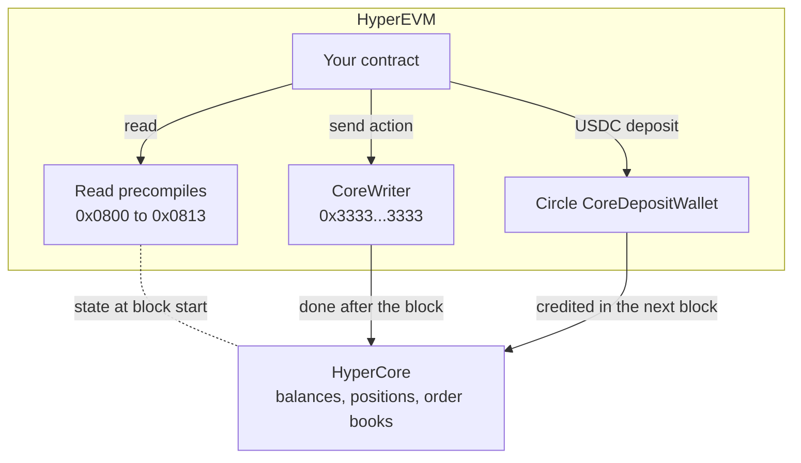
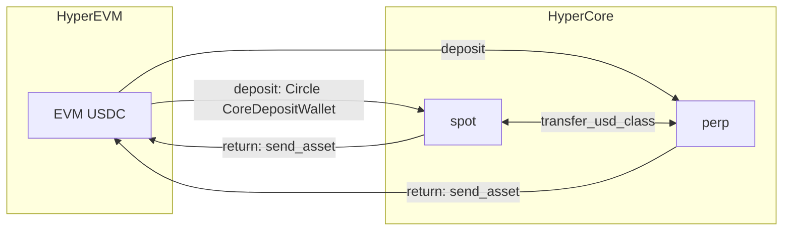
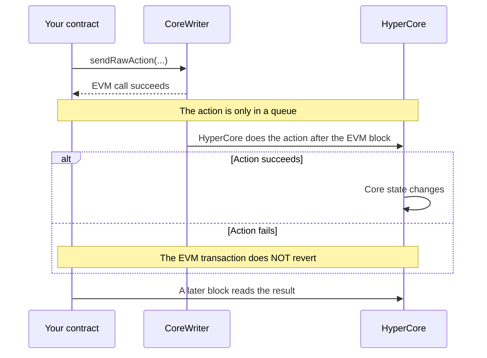
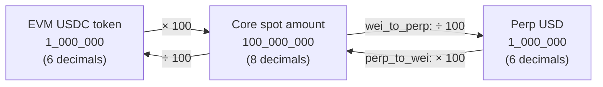

# Concepts

Two facts explain most of this library:

- There are **two sets of balances**: one on HyperEVM and one on HyperCore.
- When you **send an action**, it isn't done yet. HyperCore carries it out
  after the EVM block.

## HyperEVM and HyperCore

Hyperliquid has two systems:

- **HyperCore** is the exchange. It holds the order books, perp positions, spot
  balances, vaults and staking.
- **HyperEVM** is an Ethereum-compatible chain where smart contracts run.

A contract on HyperEVM can reach HyperCore in three ways:

**Read precompiles.** A precompile is a function built into the chain at a
fixed address. You call it with ABI-encoded arguments and get ABI-encoded bytes
back, and the `precompiles` module handles both sides for you.

**CoreWriter.** CoreWriter takes an action as raw bytes. The first 4 bytes are
a header (version `0x01`, then a 3-byte action ID), and the ABI-encoded
arguments follow it. The `core_writer` module builds these bytes for you. Here
is a full payload:

<figure class="payload">

<code class="payload-hex">01000006</code>header: version <code>0x01</code>, action 6 (spot send)

<code class="payload-hex">0000000000000000000000001212121212121212121212121212121212121212</code><code>to</code>: recipient address

<code class="payload-hex">0000000000000000000000000000000000000000000000000000000000000000</code><code>token</code>: 0 (USDC)

<code class="payload-hex">0000000000000000000000000000000000000000000000000000000005f5e100</code><code>amount_wei</code>: 100,000,000 = 1 USDC at 8 decimals

<figcaption>Payload from <code>core_writer.spot_send(0x1212&hellip;12, 0, 100_000_000)</code>. The length is 4 + 3 &times; 32 = 100 bytes. Zeros on the left of each word (faded) are padding.</figcaption>
</figure>

**USDC transfers.** A deposit goes through Circle's CoreDepositWallet contract,
and a return to EVM is a CoreWriter `send_asset` action to the USDC system
address. The `bridge` module handles both directions.

## Where your USDC can be

Think of HyperEVM as your bank account and HyperCore as your brokerage account,
with two balances inside it. USDC can be in three places:

| Where | What it is |
|---|---|
| HyperEVM | The USDC ERC-20 token that your contract holds |
| HyperCore **spot** | Cash for buying and selling tokens |
| HyperCore **perp** | Margin for perp (futures) positions, in USD |

[Units](#units) gives the decimals of each.

USDC moves in two ways:

- **Between HyperEVM and HyperCore.** A deposit goes through Circle's
  CoreDepositWallet (`bridge.bridge_usdc_to_core`), and a return is a CoreWriter
  `send_asset` to the USDC system address (`bridge.bridge_usdc_to_evm`).
  [Tutorial 4](tutorials/evm-core.md) does both.
- **Between spot and perp, inside HyperCore.** One CoreWriter action,
  `core_writer.transfer_usd_class`, moves USDC between the spot and perp
  balances, and nothing leaves HyperCore. [Tutorial 3](tutorials/spot-perp.md)
  shows it.

A contract that trades perps can deposit straight to perp DEX 0, or deposit to
spot and move margin with `transfer_usd_class`. To pay out, it moves the USDC
back to spot or returns it straight from perp to EVM.

## Actions are asynchronous

- A successful EVM transaction tells you only one thing: the action is in the
  queue.
- A precompile read returns the Core state at the start of the current EVM
  block, so a contract can't see the result of its own action in the same block.
- If your contract keeps accounts, it must mark each transfer as pending and
  later match it against the Core state it reads.

Off-chain tools have a different limit. An `eth_call` to a precompile ignores
the block tag and always returns the current Core state, even when you ask for
an old block. You can't read past Core state, so record each
reading when you take it, together with the EVM block and the Core block
(`l1_block_number`).

## Units

The same token amount is a different integer depending on where it is held. For
USDC:

| Place | Decimals | One USDC |
|---|---:|---:|
| EVM USDC token (arguments of the `bridge` functions) | 6 | `1_000_000` |
| Core token amounts (`spot_send`, `send_asset`) | 8 | `100_000_000` |
| Perp USD (`transfer_usd_class`, `vault_transfer`) | 6 | `1_000_000` |

The `bridge` functions take EVM amounts and multiply by 100 themselves.

The `core_writer` functions take Core amounts or perp amounts and don't convert
anything. If you pass an EVM amount to `spot_send`, you send 1/100 of what you
meant to.

Each Core token has metadata, which you can read with `precompiles.token_info`.

- `wei_decimals` is the number of decimals in Core token amounts. This library
  calls the integer unit of a Core amount "Core wei". It is not the 18-decimal
  Ethereum unit.
- `sz_decimals` is the number of decimals in order sizes.
- `evm_extra_wei_decimals` is how many more decimals the EVM token has than the
  Core token. For USDC the value is negative, because the EVM token has 6
  decimals and the Core token has 8.

The `conversions` functions use these values. They use integer arithmetic and
round down, so `wei_to_perp(199)` returns `1` and a small amount can convert to
zero. Check for zero before you move funds. An overflow reverts.

## Responsibilities

The library encodes requests, decodes replies, and checks units and bounds, but
it doesn't make policy decisions. [Security](security.md#what-your-contract-must-handle)
lists what the contract that imports it must handle.

## Terms

| Term | Meaning |
|---|---|
| ABI encoding | The standard byte layout for function arguments and return values |
| Allowance | Permission for one address to spend the ERC-20 tokens of another address |
| DEX index | A number that selects a Core balance context. `0` is the default perp DEX. `2**32 - 1` is spot. |
| Gas | The execution budget of the EVM |
| Revert | A failure that cancels all changes of the EVM transaction |
| System address | An address for each token. A transfer to it moves the token between Core and EVM. |

The [Hyperliquid developer documentation](https://hyperliquid.gitbook.io/hyperliquid-docs/for-developers/hyperevm/interacting-with-hypercore)
describes these interfaces in full.
