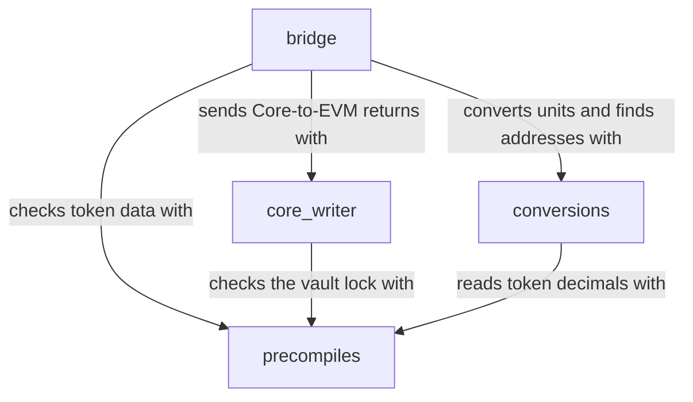

# hyper-vyper

**Build Vyper contracts on HyperEVM that read and write to HyperCore.**

`hyper-vyper` gives your HyperEVM contracts one typed interface to HyperCore, so
you can work on your protocol instead of byte layouts and decimal conversions.
With it, your contract can:

- **Read Core state** from the read precompiles: balances, perp positions,
  prices, and token and market metadata.
- **Send CoreWriter actions:** orders, cancels, transfers, staking, vault moves
  and account settings.
- **Bridge assets** (USDC, HYPE and linked ERC-20 tokens) between HyperEVM and
  HyperCore, with the decimal conversions done for you.
- **Look up indices:** find a token's Core index from its EVM address, and the
  spot market for a token pair.

The library has no state and nothing to deploy. The compiler builds the functions
you use directly into your contract.

You can test without a testnet: `hyper_vyper.testing` adds a HyperCore simulator
to your Titanoboa tests. Precompile reads, queued CoreWriter actions and bridge
transfers resolve block by block, as on HyperCore, and the tests run locally.

hyper-vyper is a Vyper port of the Solidity
[hyper-evm-lib](https://github.com/hyperliquid-dev/hyper-evm-lib/tree/4eb7ab044d0a368e0c01ec5b38d5ea48a3e3b427),
and its tests check that both libraries behave the same.

hyper-vyper is open source under the MIT license and maintained by
[CrowdCent](https://crowdcent.com).

!!! warning "Unaudited"
    This library is unaudited and provided as is.
    Read [security](security.md) before you use it with funds.

## Modules

| Module | Purpose |
|---|---|
| `precompiles` | Read Core balances, positions, prices and metadata |
| `core_writer` | Encode and send CoreWriter actions: orders, transfers, staking and more |
| `conversions` | Convert amounts between EVM, Core and order-size units |
| `bridge` | Move USDC, HYPE and linked ERC-20 tokens between HyperEVM and HyperCore |
| `constants` | Addresses, action headers and enum values |

The modules build on each other. An arrow means "uses":

Every module also uses `constants`, the shared list of addresses and IDs.

## Where to start

| You want to | Read |
|---|---|
| Install the library and compile an example | [Install and quick start](getting-started.md) |
| Test your contract against a model of HyperCore | [Testing quick start](testing/quick-start.md) |
| Understand HyperEVM, HyperCore and units | [Concepts](concepts.md) |
| Read the code module by module | [Modules](modules/index.md) |
| Try the library on testnet | [Tutorials](tutorials/index.md) |
| Look up a function or revert reason | [API reference](reference/api.md) |
| Check what your contract must add | [Security](security.md) |

## Acknowledgements

- [hyper-evm-lib](https://github.com/hyperliquid-dev/hyper-evm-lib) by
  hyperliquid-dev, the Solidity library that hyper-vyper ports.
- The [Hyperliquid documentation](https://hyperliquid.gitbook.io/hyperliquid-docs)
  on HyperEVM, HyperCore and CoreWriter.
- The [Circle documentation](https://developers.circle.com/cctp/concepts/cctp-on-hypercore)
  on USDC and the CoreDepositWallet on HyperCore.
