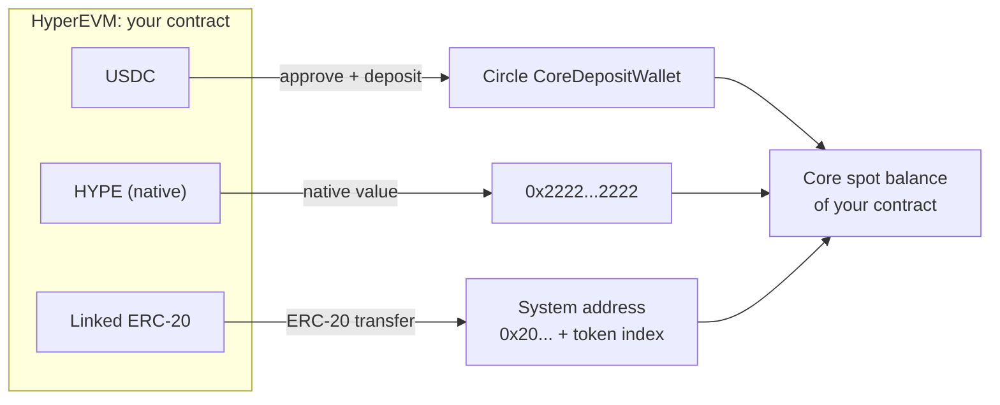
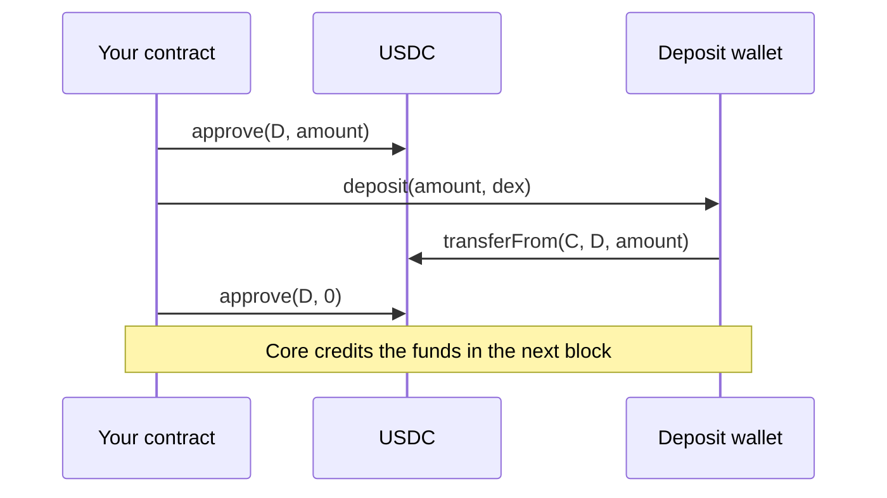

# `bridge.vy`

This module moves funds between HyperEVM and HyperCore: USDC, HYPE and linked
ERC-20 tokens. It builds on the other four modules, and a mistake here can lose
funds. Each function validates its input, calls one or two external systems
and returns. The final result arrives later, in another system, and your
contract must check it.

## The module docstring

<!-- starts: "\"\"\"" -->
```python
--8<-- "src/hyper_vyper/bridge.vy:4:40"
```

The two warnings cover activation and the DEX index. [Security](../security.md#account-setup)
explains both in full.

## Routes at a glance



`bridge_to_core` picks the route from the token index:

- USDC (token 0) goes through the deposit wallet to the spot DEX. To choose a
  perp DEX or a different recipient, use the USDC functions instead.
- HYPE goes to `0x2222...2222` as native value.
- Other linked tokens go to their system address as an ERC-20 transfer.

`bridge_to_evm` sends CoreWriter action 13 (`send_asset`) from spot to the
token's system address. HYPE arrives on EVM as native value, and other tokens
arrive as an ERC-20 transfer from the system address.

## Checks before any transfer

<!-- starts: "interface ICoreDepositWallet:" -->
```python
--8<-- "src/hyper_vyper/bridge.vy:50:75"
```

Every USDC function first calls `_validate_usdc`, which returns the amount in
Core wei:

1. `usdc_address()` reverts on an unknown network.
2. `_check_usdc_info` reads token 0 and checks two facts: Core must link USDC
   to the Circle deposit wallet, and the decimals must be 8 on Core and 6 on
   EVM. The functions below depend on the factor of 100 between the two.
3. The amount times 100 must fit in `uint64` and must not be zero.

All checks run before the first external call, so if a check fails, nothing
moves.

Core links USDC to the deposit wallet, not to the USDC token, so the first check
compares the link with the deposit wallet. The tests use replies recorded from
the real chains to check this.

## USDC from EVM to Core

<!-- starts: "@internal" -->
```python
--8<-- "src/hyper_vyper/bridge.vy:98:128"
```

Both deposit functions use `_deposit_usdc`. It deposits for the Core account of
this contract (`deposit`) or for a recipient (`depositFor`), and it makes three
external calls:



- `approve` gives the deposit wallet permission to take the amount.
- `deposit` takes the USDC and tells Core to credit this contract.
- The second `approve` sets the permission back to zero, so no permission
  remains if the wallet takes less than the approved amount.
- `default_return_value=True` accepts tokens that return no value from
  `approve`, but a token that returns `False` causes a revert.

For an activated account, Core credits the exact amount in the next block, with
no fee. On testnet, the deposit wallet credits only an address that has a
Hyperliquid mainnet account
([tutorial 4](../tutorials/evm-core.md#deposits-on-testnet-and-on-mainnet)
explains).

## USDC from Core to EVM

<!-- starts: "@internal" -->
```python
--8<-- "src/hyper_vyper/bridge.vy:131:149"
```

A return is one CoreWriter action: `send_asset` to the USDC system address
`0x2000...0000`, from the source DEX to spot. When the USDC arrives at the
system address in spot, Core sends it on to EVM.

This is the payload for a return of 1 USDC from perp DEX 0:

<figure class="payload">
<div class="payload-row"><code class="payload-hex"><span class="val">0100000d</span></code><span class="payload-label">header: version <code>0x01</code>, action 13 (send asset)</span></div>
<div class="payload-row"><code class="payload-hex"><span class="pad">000000000000000000000000</span><span class="val">2000000000000000000000000000000000000000</span></code><span class="payload-label"><code>destination</code>: USDC system address</span></div>
<div class="payload-row"><code class="payload-hex"><span class="pad">000000000000000000000000</span><span class="val">0000000000000000000000000000000000000000</span></code><span class="payload-label"><code>sub_account</code>: none</span></div>
<div class="payload-row"><code class="payload-hex"><span class="pad">00000000000000000000000000000000000000000000000000000000000000</span><span class="val">00</span></code><span class="payload-label"><code>source_dex</code>: 0 (default perp DEX)</span></div>
<div class="payload-row"><code class="payload-hex"><span class="pad">00000000000000000000000000000000000000000000000000000000</span><span class="val">ffffffff</span></code><span class="payload-label"><code>destination_dex</code>: spot (max uint32)</span></div>
<div class="payload-row"><code class="payload-hex"><span class="pad">00000000000000000000000000000000000000000000000000000000000000</span><span class="val">00</span></code><span class="payload-label"><code>token</code>: 0 (USDC)</span></div>
<div class="payload-row"><code class="payload-hex"><span class="pad">00000000000000000000000000000000000000000000000000000000</span><span class="val">05f5e100</span></code><span class="payload-label"><code>amount_wei</code>: 100,000,000 (1_000_000 &times; 100)</span></div>
<figcaption>Payload from <code>bridge.bridge_usdc_to_evm(1_000_000, 0)</code>. The helper multiplies the 6-decimal EVM amount by 100.</figcaption>
</figure>

This is how HyperCore handles each return:

| Source | Result |
|---|---|
| Spot | Arrives on EVM in the same block as the Core debit: the block after the transaction. |
| Perp DEX 0 | Arrives the same way. The Solidity library only supports spot. |
| More than the balance or `withdrawable` | Fails silently. Nothing changes, and Core charges no gas. |

Each USDC return pays a small gas fee on Core, in HYPE or, without HYPE, in USDC.
[Security](../security.md) gives the amounts.

## HYPE from EVM to Core

<!-- starts: "@internal" -->
```python
--8<-- "src/hyper_vyper/bridge.vy:152:169"
```

HYPE is the native token of HyperEVM, like ETH on Ethereum, and the function
sends native value to `0x2222...2222` with `raw_call`.

- HYPE has 18 decimals on EVM and 8 on Core, so the amount must be a multiple
  of `10**10`. Core would burn any remainder, so the function reverts instead.
- The function spends the contract's own balance, not `msg.value`, because
  internal functions cannot receive value directly.
- `raw_call` forwards all gas. The receiving system contract only emits an
  event, so it cannot call back into your contract.

## Linked ERC-20 tokens from EVM to Core

<!-- starts: "@internal" -->
```python
--8<-- "src/hyper_vyper/bridge.vy:172:194"
```

For other tokens, the function transfers the ERC-20 token to its system
address. Notice the order: all checks come first, then one external call.

The token's deployer chooses the token contract, and that contract can run any
code during `transfer`, including a call back into your contract
(reentrancy). Protect your contract, for example with `@nonreentrant`.

## Any token from Core to EVM

<!-- starts: "@internal" -->
```python
--8<-- "src/hyper_vyper/bridge.vy:212:248"
```

`bridge_to_evm` returns any token from Core spot to EVM. With
`is_evm_amount = True` the amount is in EVM units, and otherwise it is in Core
wei.

The function rejects amounts that do not convert exactly, and two helpers give
the unit size on each side:

<!-- starts: "@internal" -->
```python
--8<-- "src/hyper_vyper/bridge.vy:78:95"
```

For example, UBTC has 8 EVM decimals and 10 Core decimals, so one EVM unit is
100 Core wei. A Core amount of 199 would deliver only 1 EVM unit and lose the
other 99 wei, so the function reverts with `"Not a whole EVM unit"`
instead.

## What your contract must add

The library only submits transfers, and your contract must do the rest:
activation, a fixed DEX, pending records, HYPE for returns, access control and
reentrancy protection. [Security](../security.md#what-your-contract-must-handle)
explains each one, and [`examples/usdc_bridge.vy`](https://github.com/crowdcent/hyper-vyper/blob/main/examples/usdc_bridge.vy) shows these rules in a short contract.

## Check your understanding

1. In which order do the deposit's external calls happen, and why does the last
   `approve` set the permission to zero?
2. A return from perp succeeds on EVM, but no USDC arrives. Name two possible
   causes.
3. Why does `bridge_hype_to_core(10**10 + 5)` revert?
4. Why is reentrancy a risk in `bridge_erc20_to_core` but not in
   `bridge_hype_to_core`?
5. On mainnet, your contract deposits 100 USDC before its Core account is
   activated. What does `spot_balance` show in the next block, and why?

## Try it

```bash
uv run --locked pytest tests/test_bridge.py tests/test_bridge_generic.py -q
```

Remove the second `approve` (the reset to zero) in `_deposit_usdc`, run
the command again and read the failure. Then restore the file with
`git checkout -- src/`.

You have read the whole library. Next, try the [tutorials on
testnet](../tutorials/index.md).
