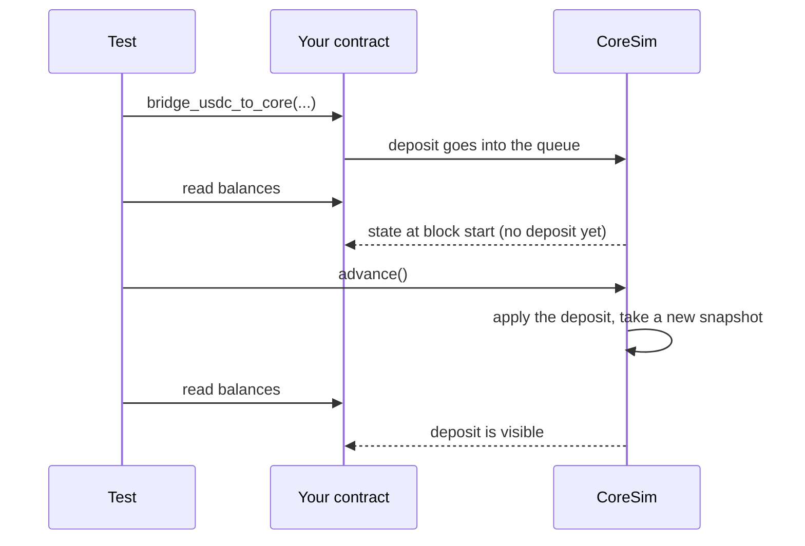

# Testing quick start

`hyper_vyper.testing` contains `CoreSim`, a small, deterministic model of
HyperCore for [Titanoboa](https://github.com/vyperlang/titanoboa) tests. Use it
when a test needs to see what Core does after an action, not just the bytes of
the action.

On this page you write a test that moves USDC from EVM to Core spot, back to EVM
and then to perp, with `CoreSim` standing in for HyperCore. You don't need a
wallet, an RPC endpoint or funds.

## 1. Install

Add the library, then add its `testing` extra and pytest to your test
environment. The extra adds Titanoboa 0.2.8 and eth-abi.

```bash
uv init my-contracts
cd my-contracts
uv add hyper-vyper
uv add --dev "hyper-vyper[testing]" pytest
```

## 2. Write the contract

Save this contract as `spot_round_trip.vy`. It is the same file as
[`examples/spot_round_trip.vy`](https://github.com/crowdcent/hyper-vyper/blob/main/examples/spot_round_trip.vy), and it imports all five modules.

```vyper
--8<-- "examples/spot_round_trip.vy"
```

The contract has no access control, so use it only in tests.

## 3. Write the test

Save this test as `test_spot_round_trip.py`, next to the contract. It is the
same file as [`examples/test_spot_round_trip.py`](https://github.com/crowdcent/hyper-vyper/blob/main/examples/test_spot_round_trip.py).

```python
--8<-- "examples/test_spot_round_trip.py"
```

The test works through these steps:

1. The `sim` fixture resets the Titanoboa environment and installs `CoreSim`
   with the mainnet addresses (chain 999). After the test, it removes the
   precompile callbacks.
2. `sim.usdc.mint` gives the contract mock USDC on EVM.
3. `sim.activate` and `sim.set_hype` create an activated Core account with a
   little HYPE. An activated account gets the exact deposit, with no 1 USDC
   fee, and the HYPE pays the gas of the return. `sim.publish()` makes this setup visible to reads at once.
4. `deposit_to_spot` sends the deposit. A read in the same block still shows
   0, because Core runs after the EVM block.
5. `sim.advance()` ends the block, Core applies the deposit, and the next read
   shows it.
6. The return and the move to perp work the same way, and each needs a
   `sim.advance()` before its result is visible.
7. `sim.failures` is empty, so no action failed silently on Core.

## 4. Run the test

```bash
uv run pytest
```

Next, test the failure paths too. For example,
`sim.fail_next("send_asset")` makes the next return fail silently on Core, and
you can check that your contract keeps the transfer as pending. Change
[`Policy`](#settings) fields to test other Core behavior.

## How CoreSim works

`CoreSim.install(chain_id)` prepares the Titanoboa EVM:

- It deploys mock USDC, a mock Circle CoreDepositWallet, a journal at the
  CoreWriter address and a mock at the HYPE system address (`0x2222...2222`), each
  at its real address for the chain.
- It registers Python callbacks at the read precompiles (`0x0800` to `0x0813`).

After that, a test runs like this:

1. Precompile reads give the Core state at the **start** of the block, so a
   transaction never sees its own Core effects.
2. CoreWriter actions, USDC deposits and HYPE transfers go into a queue. A
   reverted EVM transaction leaves nothing in the queue.
3. `sim.advance()` ends the block. Core applies the queued items in order, pays
   Core-to-EVM returns on EVM and takes a new snapshot.
4. A failed item changes nothing on Core, and the EVM transaction does not
   revert. `sim.events` and `sim.failures` record the reason.



Move blocks only with `sim.advance()`. A raw `boa.env.time_travel` moves the EVM
block without moving Core, and the next read then raises an error.

## What the model follows

These rules come from the
[Hyperliquid documentation](https://hyperliquid.gitbook.io/hyperliquid-docs/for-developers/hyperevm/interacting-with-hypercore),
the
[Circle documentation](https://developers.circle.com/cctp/concepts/cctp-on-hypercore),
and, for the rules that those documents don't state, transactions on mainnet
and testnet.

- Reads show Core state as of the start of the EVM block.
- CoreWriter actions run after the EVM block, and failures are silent on EVM. A
  failed action pays no gas.
- A transfer, a return or a deposit sent in EVM block N shows in block N+1.
- Orders and vault transfers have an extra delay of a few seconds.
- USDC has 6 decimals on EVM, 8 on Core spot and 6 for perp USD.
- Core token 0 (USDC) links to the CoreDepositWallet, not to the USDC token.
- A CoreDepositWallet deposit credits the exact amount, with no fee. A deposit
  to an account that is not activated activates it, and Core takes the 1 USDC fee from
  the amount. A deposit to a DEX that does not exist credits spot.
- An account is missing, escrow-only or activated (`sim.account_state`).
- An account that is not activated cannot send CoreWriter actions, and its
  actions fail with "sender not activated".
- A HYPE or linked-token transfer to an account that is not activated goes to
  escrow. The
  precompiles don't show escrow (`core_user_exists` is false and
  `spot_balance` is 0), but `sim.escrow(user)` does.
- A Core send of 1 USDC or more to an account that is not activated activates
  it. The
  sender pays the 1 USDC fee, and the escrow moves to spot.
- A `send_asset` from perp DEX 0 to the USDC system address returns USDC to
  EVM.
- The Core debit and the EVM credit of a return land in the same block, and the
  EVM credit is a system transaction at the start of that block.
- A USDC return costs gas in HYPE, or in USDC when the account holds no HYPE,
  as [security](../security.md#account-setup) describes. If nothing can pay
  both the amount and the gas, the return fails.

## Settings

`Policy` holds the simulator's timing and behavior settings. The defaults
follow the documentation and the behavior measured on chain. To test your
contract against other behavior, change a field:

```python
sim = CoreSim.install(chain_id=998, policy=Policy(delayed_action_blocks=5))
```

| `Policy` field | Default | Meaning |
|---|---|---|
| `block_time` | `1` | Seconds per small EVM block. |
| `transfer_delay_blocks` | `1` | Blocks until Core applies an action: the next block. |
| `delayed_action_blocks` | `3` | Blocks for orders and vault transfers. The Hyperliquid documentation gives the delay as a few seconds. |
| `deposit_delay_blocks` | `1` | Blocks from the deposit wallet to Core: the next block. |
| `evm_credit_extra_blocks` | `0` | Extra blocks for the EVM payout after the Core debit. On chain, both land in the same block. |
| `evm_transfer_fee_hype_wei` | `2_000` | Return gas in Core HYPE units. |
| `evm_transfer_fee_usdc_fallback_wei` | `92_700` | Return gas in Core USDC units when spot has no HYPE: 0.000927 USDC, a testnet value. Mainnet charges 0.001 to 0.002 USDC. |
| `new_account_fee` | `1_000_000` | Activation fee: 1 USDC in perp units. |
| `deposit_to_inactive` | `"activate"` | A CoreDepositWallet deposit to an account that is not activated: `"activate"` (it activates the account and pays the 1 USDC fee from the amount) or `"drop"` (the testnet wallet, for an address without a mainnet account). |
| `vault_lock_ms` | `86_400_000` | Lock of a user-vault deposit: 1 day. |

Other simplifications:

- One L1 block per EVM block. On chain, HyperCore makes about 13 to 20 L1
  blocks per EVM block.
- Returned USDC comes from the mock deposit wallet's reserve, and the simulator
  mints more if the reserve is too small.
- A Core send of less than 1 USDC to an account that is not activated fails.
- A spot-to-perp amount in Core wei that is not a multiple of 100 fails.
- A return of a token other than USDC or HYPE fails without HYPE on Core.
- Perp `withdrawable` is the account value minus the margin used, unless you
  set it directly.

## Limits

- There is no matching engine, order book, funding, liquidation or margin math.
  The simulator records orders, cancels, staking, delegation, borrow and lend,
  builder fees and token finalization, but doesn't apply them.
- Abstraction modes and API wallets are only stored, so they change no balances.
- Transfers model only perp DEX 0, and there are no sub-accounts.
- The simulator doesn't see an ERC-20 sent to a system address, so call
  `sim.bridge_in(user, token, amount_wei)` after the send. A revert does not
  undo `bridge_in`.
- The HYPE system mock writes to storage, so a HYPE send with the 2,300 gas
  stipend (`send`) fails here even though it succeeds on chain. Use `raw_call`.
- Setup helpers (`set_spot`, `set_perp`, `set_hype`, `activate`) activate an
  account without a fee.
- A precompile without a model reverts. Use `sim.set_reply` to give it a fixed
  reply.
- The journal stores actions in storage, so CoreWriter gas is higher than on
  chain. Don't use the simulator for gas measurements.

## Useful methods

| Method | Use |
|---|---|
| `CoreSim.install(chain_id, policy)` | Deploy the mocks and register the precompiles. Use 999 (mainnet) or 998 (testnet). |
| `sim.close()` | Remove the precompile callbacks. |
| `sim.advance(blocks=1)` | End the block and let Core run. |
| `sim.activate(*users)` | Activate accounts without a fee, for test setup. |
| `sim.set_spot`, `sim.set_hype`, `sim.set_perp` | Set Core balances for test setup. |
| `sim.set_price`, `sim.set_position`, `sim.set_vault_equity` | Set prices, positions and vault equity. |
| `sim.publish()` | Make setup changes visible to reads in the current block. |
| `sim.spot(user)`, `sim.perp(user)`, `sim.escrow(user)` | Read the live Core state. |
| `sim.events`, `sim.failures`, `sim.pending` | Inspect what Core did. |
| `sim.fail_next(name, reason)` | Make the next action fail on Core. |
| `sim.usdc` | The mock USDC contract. Use `sim.usdc.mint(address, amount)`. |

`hyper_vyper.testing` also exports the addresses and values that the simulator
uses:

| Name | Value |
|---|---|
| `USDC`, `WALLET` | The USDC token and the Circle CoreDepositWallet, as `{chain_id: address}` |
| `CORE_WRITER`, `HYPE_SYSTEM` | The CoreWriter address and the HYPE system address `0x2222...2222` |
| `USDC_TOKEN`, `HYPE_TOKEN` | The Core token index of USDC (0), and of HYPE as `{chain_id: index}` |
| `SPOT_DEX` | The DEX index for spot |
| `system_address(token, chain_id)` | The system address of a linked token |
| `live_reply(name, chain_id)` | A precompile reply recorded from the real chain |

## Test against live HyperCore state

`forward_precompiles` answers the HyperCore read precompiles from a live node
instead of the simulator. Titanoboa's fork mode runs your contract on a local
copy of the chain, and that copy has no HyperCore precompiles, so a contract
that reads Core state needs this helper there:

```python
import boa
from hyper_vyper.testing import forward_precompiles

RPC = "https://rpc.hyperliquid.xyz/evm"

with forward_precompiles(RPC):
    boa.fork(RPC)
    contract = boa.load("read_core.vy")
    print(contract.core_usdc_balance("0xSOME_ADDRESS"))  # the live Core balance
```

The helper works in network mode (`boa.set_network_env`) too, and the
[tutorial scripts](../tutorials/index.md#how-the-scripts-work) use it in both
modes.

- The node answers with the HyperCore state at its latest block, not at the
  block of the fork.
- A CoreWriter action in the fork only emits its event. Use `CoreSim` to test
  what Core does after an action.
- In network mode, Titanoboa compares each local view result with the node's.
  The local copy of the chain moves forward only when the script sends a
  transaction, so a view that returns `block.number` differs. Titanoboa then
  warns "local fork did not match node!" and returns the node's result.

## Check on testnet

A simulator can share a wrong assumption with your contract. Before you put
funds in a contract, run it on testnet with small amounts. The
[tutorials](../tutorials/index.md) show how.
