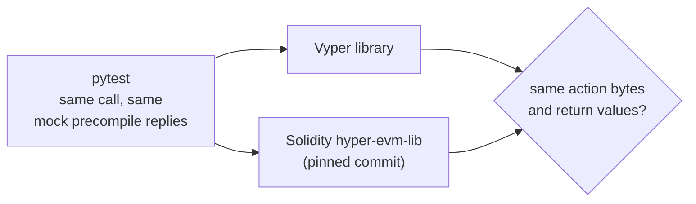

# Repository tests

To test your own contracts, read the [testing quick start](quick-start.md).

The tests use [Titanoboa](https://github.com/vyperlang/titanoboa), which
compiles Vyper contracts and runs them in an EVM inside Python.

```bash
uv run --locked pytest                     # local tests, no network
uv run --locked pytest tests/test_sim.py   # HyperCore simulator tests only
uv run --locked pytest -m packaging        # build and install the wheel
uv run --locked pytest -m fork             # read-only tests on mainnet RPC
```

## Mock tests

Most tests replace HyperCore with mocks:

- Python callbacks at the precompile addresses return replies that the test
  selects.
- A recording contract at the CoreWriter address stores each action.
- Mock USDC and mock deposit-wallet contracts record balances and allowances.

The mock tests don't model HyperCore. They check the bytes that the library
sends, but not what HyperCore does with those bytes. For that, use the
[HyperCore simulator](quick-start.md#how-coresim-works).

## Recorded chain data

Some tests use precompile replies that [`scripts/record_live_replies.py`](https://github.com/crowdcent/hyper-vyper/blob/main/scripts/record_live_replies.py) recorded
from mainnet and testnet, stored in [`src/hyper_vyper/testing/data/live_replies.json`](https://github.com/crowdcent/hyper-vyper/blob/main/src/hyper_vyper/testing/data/live_replies.json).
The file is in the package because the simulator uses the USDC and HYPE
entries, and your tests can read every entry with `live_reply`.
Use recorded replies when a test depends on real chain metadata, because a
hand-written reply can share a wrong assumption with the code.

A fork test compares each recorded reply with the live chain. If it fails, the
chain data has changed, so record the replies again and review the difference:

```bash
uv run --locked scripts/record_live_replies.py
```

## HyperCore simulator tests

[`tests/test_sim.py`](https://github.com/crowdcent/hyper-vyper/blob/main/tests/test_sim.py), [`tests/test_examples.py`](https://github.com/crowdcent/hyper-vyper/blob/main/tests/test_examples.py) and [`tests/test_tutorials.py`](https://github.com/crowdcent/hyper-vyper/blob/main/tests/test_tutorials.py) use
`CoreSim` from `hyper_vyper.testing`.
The [testing quick start](quick-start.md) explains what it models and what it leaves out.

## Packaging test

[`tests/test_packaging.py`](https://github.com/crowdcent/hyper-vyper/blob/main/tests/test_packaging.py) builds the wheel and installs it in a new uv project.
It then compiles a contract with both the `vyper` command and Titanoboa, and
runs the [testing quick start](quick-start.md) test. uv downloads Vyper and
Titanoboa if they aren't already in its cache. The test doesn't run by default:

```bash
uv run --locked pytest -m packaging
```

## Comparison with Solidity

[`tests/reference/Reference.sol`](https://github.com/crowdcent/hyper-vyper/blob/main/tests/reference/Reference.sol) exposes functions from the Solidity
hyper-evm-lib to the tests. The sources are unchanged and come from a pinned
commit.

Many test files deploy both the Vyper and the Solidity version, for
example `test_reference.py`, `test_parity_reads.py`, `test_actions.py`,
`test_decoding.py`, `test_bridge.py` and `test_bridge_generic.py`. They give both
versions the same calls and the same precompile replies, and then check that
both send the same bytes and return the same values.



[`tests/reference/upstream.json`](https://github.com/crowdcent/hyper-vyper/blob/main/tests/reference/upstream.json) lists the Solidity sources with their URLs and
SHA-256 hashes. The compiled `artifact.json` is checked into the repository, so
pytest doesn't need Node or network access.

To rebuild the artifact with solc 0.8.30 and check that it is identical, run:

```bash
npm ci --prefix tests/reference --ignore-scripts --no-audit --no-fund
uv run --locked scripts/solidity_reference.py --check
```

The `--fetch` option downloads the pinned sources again before the rebuild.

## Fork tests

Tests with the `fork` marker call the real precompiles through a HyperEVM
mainnet RPC. They only read, and they don't run by default. Each call reads the
latest block, so two calls can see different blocks.

## Real HyperCore behavior

Local tests can't prove what HyperCore does, so the
[tutorials](../tutorials/index.md) run on HyperEVM testnet (chain 998) with
small amounts. `tests/test_tutorials.py` runs the same contracts and scripts
against `CoreSim`, without network access.
