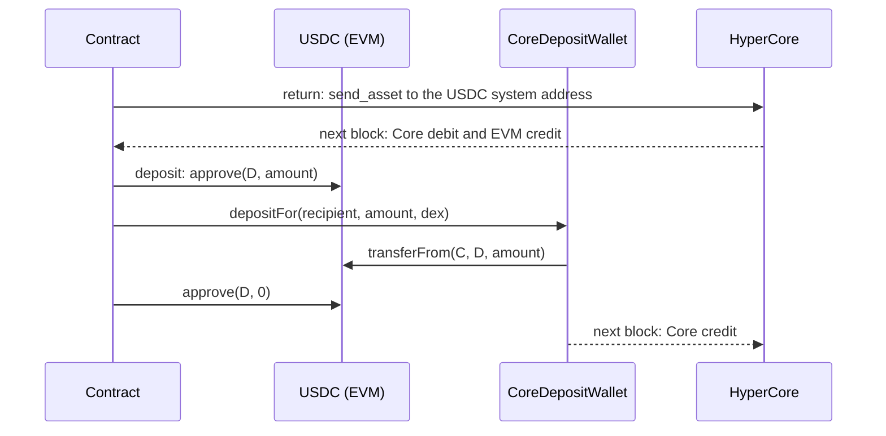

# 4. Move USDC between EVM and Core

In this tutorial a contract moves USDC between HyperEVM and HyperCore. It
returns USDC from Core to EVM with `bridge.bridge_usdc_to_evm`, and deposits it
back through Circle's CoreDepositWallet with `bridge.bridge_usdc_to_core_for`.
[Tutorial 3](spot-perp.md) moves USDC between spot and perp inside HyperCore.

You'll learn:

- How to return USDC from Core spot and Core perp to EVM, and deposit it back.
- How to keep each transfer pending until a later block shows it, and confirm
  it then. Both directions arrive in the next block.
- What a return costs in gas: about 0.00002 HYPE, or about 0.0009 USDC on
  testnet when the contract holds no HYPE.
- What a silent failure looks like, and how to clear its pending record safely.

## Prerequisites

| Item | Amount |
|---|---|
| HYPE on HyperEVM | less than 0.003 HYPE for gas |
| USDC in the spot balance of your Core account | 7 USDC: 6 USDC to the contract and 1 USDC activation fee |
| HYPE in the spot balance of your Core account | 0.01 HYPE |
| A Hyperliquid mainnet account on the same address | for the deposit step only (see below) |
| `HYPER_VYPER_TESTNET_KEY` | for all steps with `--execute` |
| `HYPER_VYPER_CORE_FUNDER_KEY` | optional, for the fund step |

If you have no Core HYPE, buy some as
[testnet setup](testnet-setup.md#get-usdc-on-hypercore) describes.

## Deposits on testnet and on mainnet

On testnet, Circle's CoreDepositWallet credits only an address that already has
a Hyperliquid **mainnet** account. A new contract never has one, so on testnet
the deposit step deposits into **your own** Core account with
`bridge_usdc_to_core_for`. The testnet faucet has the same condition, so if you
used it, your address qualifies.

On mainnet, a contract deposits into its own Core account in the same way, with
`bridge.bridge_usdc_to_core`. A production contract uses this route.
[Security](../security.md#account-setup) gives the rules for the activation fee
and the DEX index.



## HYPE for gas on Core

A return to EVM is a Core action that makes an EVM transfer. When the sender
holds HYPE, Core charges the EVM gas of that transfer in HYPE, and it takes the
HYPE from the Core **spot** balance of the sender, which is the contract.

- The charge is about 200,000 gas. At a base fee of 0.1 gwei, that is
  0.00002 HYPE, or about 2,000 Core wei (8 decimals).
- If the contract holds no HYPE, a spot return still succeeds, and Core takes
  the gas in USDC from spot instead: 0.001 to 0.002 USDC per return on mainnet,
  and about 0.0009 USDC on testnet. The amount changes with the HYPE price and
  the base fee.
- A perp return without HYPE also succeeds. Core takes the gas in USDC from
  spot, or from perp when spot has no USDC.
- A deposit, a HYPE return to EVM and a failed action cost no Core gas.

Keep a small HYPE balance on Core, so the fee comes from HYPE and the USDC
amounts stay exact. The fund step sends the contract 0.01 HYPE.

## The contract

[`tutorials/evm_core/evm_core.vy`](https://github.com/crowdcent/hyper-vyper/blob/main/tutorials/evm_core/evm_core.vy)
is based on
[`examples/usdc_bridge.vy`](https://github.com/crowdcent/hyper-vyper/blob/main/examples/usdc_bridge.vy):

```vyper
--8<-- "tutorials/evm_core/evm_core.vy"
```

- `return_usdc` checks the owner, a free pending slot, the activation and the
  source balance. It records the pending return, with the EVM USDC balance as
  the baseline, and then sends the action. The source DEX is fixed: perp DEX 0
  or spot.
- `deposit` checks the owner, a free pending slot, the EVM balance and that
  the owner has a Core account. It records the pending deposit, with the
  owner's Core spot USDC as the baseline, and then deposits for the owner to
  spot.
- `observed` is true in a later block if the destination grew by the amount:
  the EVM USDC balance for a return, or the owner's Core spot USDC by
  `amount * 100` for a deposit (6 decimals on EVM, 8 on Core spot).
- `confirm` clears the pending transfer after it is observed.
- `return_spot_unchecked` exists only for the failure demo. It sends a spot
  return without the balance check, whereas a real contract checks the
  balance, as `return_usdc` does.
- `abandon` clears a pending transfer that did not arrive. Core does not report
  failures, so `abandon` waits until Core has processed the action: 200 L1
  blocks, about 15 seconds. A successful transfer shows in the next EVM block.
  For a return, `abandon` also refuses if Core took the USDC, so you can't
  abandon a return that Core has already paid out.

Other transfers to the same balance can make a transfer look done, so don't move
other funds in or out of the contract while a transfer is pending.

## Steps

1. Deploy the contract:

    ```bash
    uv run --locked tutorials/evm_core/run.py deploy --execute
    ```

2. Fund the contract with 6 USDC and 0.01 HYPE on Core. The USDC send activates
   the account:

    ```bash
    uv run --locked tutorials/evm_core/run.py fund --execute
    ```

    ```text
    Core transfer: 6 USDC from your Core account to 0x...
      block N: exists True, spot USDC 600000000 (6 USDC, 8 decimals)
    Core transfer: 0.01 HYPE from your Core account to 0x...
      block N+7: spot HYPE 1000000 (0.01 HYPE, 8 decimals)
    ```

3. Return 2 USDC from Core spot to EVM:

    ```bash
    uv run --locked tutorials/evm_core/run.py return-spot --amount 2 --execute
    ```

    ```text
    return 2000000 (2 USDC, 6 decimals) from Core spot to EVM
    plan: return_usdc(2000000, False) value 0
    sent return_usdc: 0x... in block N
      block N+10: EVM USDC 2, spot USDC 4, withdrawable 0, spot HYPE 0.00998
    change: EVM USDC 2000000 (2 USDC, 6 decimals)
    change: Core spot USDC -200000000 (-2 USDC, 8 decimals)
    change: withdrawable 0 (0 USD, 6 decimals)
    change: Core spot HYPE -2000 (-0.00002 HYPE, 8 decimals)
    observed: the USDC is on EVM. Confirm the pending return.
    plan: confirm() value 0
    sent confirm: 0x... in block N+35
    ```

    The EVM credit and the Core debit show up together, and the gas came from
    Core HYPE.

4. Move 2 USDC to perp, then return it from perp:

    ```bash
    uv run --locked tutorials/evm_core/run.py to-perp --amount 2 --execute
    uv run --locked tutorials/evm_core/run.py return-perp --amount 2 --execute
    ```

    ```text
    return 2000000 (2 USDC, 6 decimals) from Core perp to EVM
    plan: return_usdc(2000000, True) value 0
    sent return_usdc: 0x... in block N
      block N+11: EVM USDC 4, spot USDC 2, withdrawable 0, spot HYPE 0.00996
    change: EVM USDC 2000000 (2 USDC, 6 decimals)
    change: Core spot USDC 0 (0 USDC, 8 decimals)
    change: withdrawable -2000000 (-2 USD, 6 decimals)
    change: Core spot HYPE -2000 (-0.00002 HYPE, 8 decimals)
    observed: the USDC is on EVM. Confirm the pending return.
    ```

5. Optional: see a silent failure. This step returns 1 USDC more than the spot
   balance:

    ```bash
    uv run --locked tutorials/evm_core/run.py return-too-much --execute
    ```

    ```text
    Failure demo: this return is 1 USDC more than the Core spot balance.
    return 3000000 (3 USDC, 6 decimals) from Core spot to EVM
    plan: return_spot_unchecked(3000000) value 0
    sent return_spot_unchecked: 0x... in block N
      block N+11: EVM USDC 4, spot USDC 2, withdrawable 0, spot HYPE 0.00996
      ...
      block N+33 (+22): EVM USDC 4, spot USDC 2, withdrawable 0, spot HYPE 0.00996
    change: EVM USDC 0 (0 USDC, 6 decimals)
    change: Core spot USDC 0 (0 USDC, 8 decimals)
    change: withdrawable 0 (0 USD, 6 decimals)
    change: Core spot HYPE 0 (0 HYPE, 8 decimals)
    NOT observed: Core rejected the return. The EVM transaction succeeded, and the return stays pending. After 200 L1 blocks (about 15 seconds), run the abandon step.
    ```

    Nothing moved and no gas was charged. Clear the pending record:

    ```bash
    uv run --locked tutorials/evm_core/run.py abandon --execute
    ```

    If the step stops with `Too early`, wait a few seconds and run it again.

6. Optional: return without HYPE. Send the contract's Core HYPE to you, then
   return 1 USDC from spot:

    ```bash
    uv run --locked tutorials/evm_core/run.py remove-hype --execute
    uv run --locked tutorials/evm_core/run.py return-spot --amount 1 --execute
    ```

    ```text
    Note: the contract has no Core HYPE, so Core takes the gas in USDC: about 92700 (0.000927 USDC, 8 decimals).
    return 1000000 (1 USDC, 6 decimals) from Core spot to EVM
    ...
    change: EVM USDC 1000000 (1 USDC, 6 decimals)
    change: Core spot USDC -100092100 (-1.000921 USDC, 8 decimals)
    change: withdrawable 0 (0 USD, 6 decimals)
    change: Core spot HYPE 0 (0 HYPE, 8 decimals)
    observed: the USDC is on EVM. Confirm the pending return.
    ```

    Core took 1.000921 USDC from spot: the amount plus 0.000921 USDC of gas.

7. Deposit 1 USDC from the contract's EVM balance back to Core, into the spot
   balance of your own Core account:

    ```bash
    uv run --locked tutorials/evm_core/run.py deposit --amount 1 --execute
    ```

    ```text
    deposit 1000000 (1 USDC, 6 decimals) into the Core spot balance of 0x...
    plan: deposit(1000000) value 0
    sent deposit: 0x... in block N
      block N+9: owner Core spot USDC 1001.0
    change: EVM USDC -1000000 (-1 USDC, 6 decimals)
            owner Core spot USDC 100000000 (1 USDC, 8 decimals)
    observed: the USDC is on Core. Confirm the pending deposit.
    sent confirm: 0x... in block N+15
    ```

    The contract's EVM USDC fell by exactly 1 USDC and your Core spot USDC grew
    by exactly 1 USDC, so the deposit paid no fee.

    If the step prints `NOT observed`, your address has no mainnet account, so
    the testnet deposit wallet didn't credit it. Wait about 15 seconds and run
    the abandon step. Either way, the deposit wallet has taken the EVM USDC.

8. Clean up. Send the contract's EVM USDC to you on EVM, then its Core USDC and
   HYPE to you on Core:

    ```bash
    uv run --locked tutorials/evm_core/run.py withdraw --execute
    uv run --locked tutorials/evm_core/run.py sweep --execute
    ```

The USDC that came back to EVM stays as EVM USDC in your address. You lose the
1 USDC activation fee and the Core gas of the returns.

## What can go wrong

- **`A transfer is pending`.** The contract allows one pending transfer at a
  time. Run the confirm step, or run `abandon` after Core has processed it.
- **`Spot balance too low` or `Not withdrawable`.** The contract checks the
  source before it sends. Run the fund or to-perp step first.
- **`Too early`.** `abandon` waits 200 L1 blocks, about 15 seconds.
- **`Core took the USDC`.** Core took the USDC, so the return succeeded. Run the
  confirm step.
- **`Owner has no Core account`.** Activate your address on testnet Core first,
  as [testnet setup](testnet-setup.md) describes.
